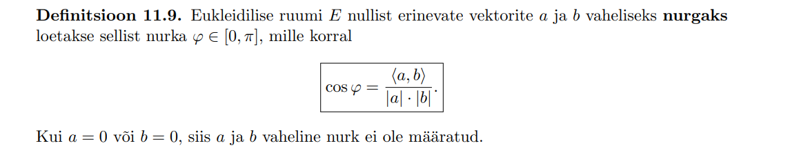
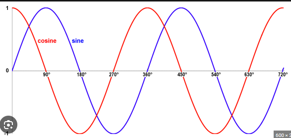
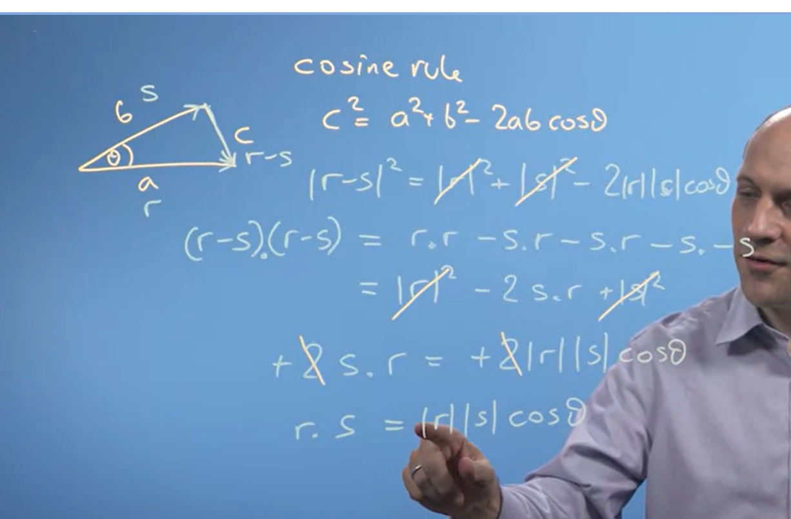
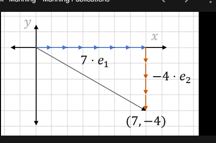
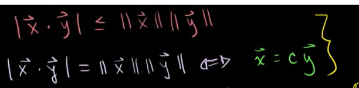
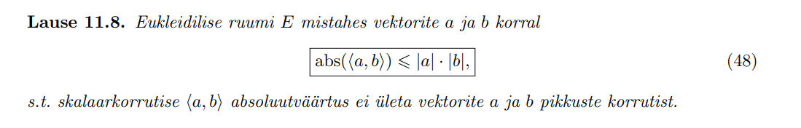
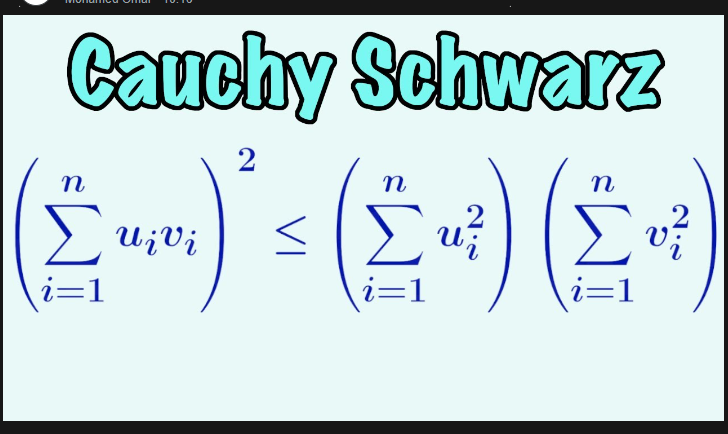
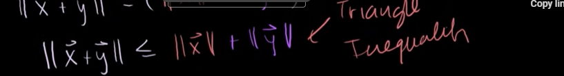
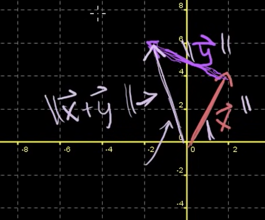
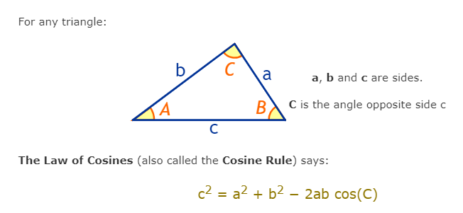

# ANGLE DEEP DIVE

- [NURGA TULETUSKÄIK](#0824d93f-dc0a-4a3b-bfe0-fb7d0e130d18)
- [**MIKS ON NURK SEOTUD SIINUSE VÕI KOOSINUSEGA?**](#3a7da8d3-8e75-4917-967d-78f250327688)
- [OTHER WAYS TO THINK ABOUT ANGLE](#8ec8ef24-350c-4537-9557-dc71a0712100)
  - [ANGLE IDEA](#37570772-142f-4f02-8885-8bdf9349c7c4)
    - [DERIVATION OF ANGLE BETWEEN VECTORS FROM COSINE RULE - ML MATH COURSE](#7fba8e7c-991b-4ce6-9072-2d70fbb8a4ed)
- [ANGLE PROPERTIES](#7d194c22-0b8a-4f9b-945a-e8c7d90d58a7)
- [PREREQUISITES FOR ANGLE](#afb89d77-4c0c-41fd-a1c2-1f7d7e74547b)
  - [DOT PRODUCT AND LENGTH](#544cfdfd-1902-4547-a308-cdc288b093cd)
  - [CAUCHY SWARCH](#e8d3bd90-ed43-4a58-ba62-6d2efd3596bc)
  - [TRIANGLE INEQUALITY](#7dea1cf0-3445-46d2-b3b9-55ddfe1c7b9d)
  - [REMINDER OF COSINE AND SINUS](#8f440cf6-b9db-4361-b011-0c9d8766ef05)
  - [**COSINE RULE**](#d47b21ba-208d-40d5-a134-f585a1ac3e4a)

## NURGA TULETUSKÄIK

Suures plaanis tasandil defineeritu nurgast vektorite vahelise nurgani minemine näeb välja midagi sellist, kus me liigume geomeetrilisest ruumist **eukleidilisse** vektorruumi. Me kasutame midagi sellist nagu isomorfimismid, kus me toome mingist ruumist omadused üle. Täpsemalt me tõestame, et nende vahel esineb isomorfism.

Eukleidilises vektorruumis on meie jaoks defineeritud ära

- skalaarkorrutis
- pikkus

Nende abil saamegi **<u>defineerida</u>** nurga.

Algebraliselt on nurk 2 vektori vahel defineerimiseks , oletame et need vektorid on **a ja b**

Oletame, et meil on 3 vektor

- a-b

Ja oletame, et meil on pikkus defineeritud vektorrruumis. Selleks on

$\sqrt{a\cdot a}$

Ja me mõõdame iga elemendi pikkust

- a
- b
- a-b

KhanAcademys nüüd tõestatakse, et selliste pikkustega kolmnurka alati võimalik moodustada. Tõestamine kasutades teoreemi

> (triangle inequality) $||x+y|| ≤||x||+||y||$ [link](https://app.notion.com/p/ANGLE-DEEP-DIVE-81a4f30190024db7a81946386017a84a?pvs=21)

- Ei kehti ||a|| > ||b|| + ||a-b||
  - ||a|| = ||b+(a-b)|| ≤ ||b|| + ||a-b|| because of triangle inequality $\cdot$
- Ei kehti ||b|| > ||a|| + ||a-b||
  - ||b||=||a+(b-a)||
    - ||a-b||=||b-a|| ⇒ ||a|| + ||a-b|| = ||a|| + ||b-a||
    - ||a+(b-a)||≤||a|| + ||b-a|| $\cdot$
- Ei kehti ||a-b|| > ||a|| + ||b||
  - ||b+(a-b)+a+(b-a)|| = ||a+b||
  - ||a+b||≤||a||+||b|| $\cdot$

Kui me oleme selle tõestanud, siis saame omadust, et võimalik on moodustada kolmnurka kasutada ära järgmistes sammudes.

*Okei, aga kas on võimalik moodustada äkki mitut sellist kolmnurka? Nii, et a ja b vahel oleks erinevad nurgad*

- Ei, sest kui a ja b vahel oleks mõni muu nurk ning a ja b pikkused oleks samad, siis sellisel juhul oleks kohe a-b pikkus ka erinev.
- On võimalik moodustada võrdelist kolmnurka, kus a ja b vaheline nurk on täpselt sama ning pikkused mingi kordajaga vähendatud/ssuurendatud

Kui oleme defineerinud kolmnurga võimalikuse, siis me defineerimegi a,b,a-b vektorite pikkuste **kiirtega** kolmnurga ja **<u>DEFINEERIME</u>,** et nurk **vektori** a ja b vahel on see sama nurk, mis on, nurk a ja b **kiirte** vahel selles samas kolmnurgas

- *NB, siin eristame kontseptuaalselt vektoreid ja tasandil defineeritud kolmnurga kiiri, aga toome läbi isomorfismi tasandil defineeritud reeglid vektorruumi üle ja defineerime selle läbi nurga.*

Edasi saame kasutada koosinuse reeglit, mis kehtib kolmnurkadel.

> $||a-b||^2 = ||a||^2+||b||^2 - 2||a||||b||\cos(\theta),\text{kus }\theta \text{ on nurk a ja b vahel}$ [link](https://app.notion.com/p/ANGLE-DEEP-DIVE-81a4f30190024db7a81946386017a84a?pvs=21)

Arvutame selle nüüd lahti

$(a-b)\cdot(a-b) = a\cdot a + b\cdot  b - 2||a||||b||cos(\theta)$

$a\cdot a -2a\cdot b +  b\cdot  b = a\cdot a + b\cdot  b - 2||a||||b||cos(\theta)$

$(a\cdot b)  =  ||a||||b||cos(\theta)$

$\frac{(a\cdot b)}{||a||||b||}  =  cos(\theta)$ ⇒ a ja b vahelise nurga koosinus

if a=cb and c>0 ⇒ $cos(\theta)=1$ ⇒ $\theta=0\degree$

if a=cb and c&lt;0 ⇒ $cos(\theta)=-1$ ⇒ $\theta=180\degree$

[Proof: Angle Between Two Vectors (youtube.com)](https://www.youtube.com/watch?v=wC53r_Uw3Mo)

## **MIKS ON NURK SEOTUD SIINUSE VÕI KOOSINUSEGA?**

1. Kui me võtame ringi, siis olenemata ringi suurusest on ringi ümbermõõdu ja diameetri vaheline jagatis $\pi$
2. Me saame sarnast asja teha täisnurkse kolmnurga puhul. Kui me võtame täisnurkse kolmnurga, siis on olenemata kolmnurga suurusest nurga $\theta$ siinus $\frac{opposite}{hypothenus}$ koosinus = $\frac{adjacent}{opposite}$ sama kõikide täisnurksete kolmnurkade $\theta$ puhul . See on loogiline, sest, kui meil on täisnurkne kolmnurk, mille üks külg on $\theta$ ja teine külg on 90 $\degree$, siis kolmas külg on alati $180\degree-90\degree-\theta\degree$ ja teiste samade nurkadega kolmnurk on lihtsalt kolmnurk, kus iga külg on mingi korrutis eelnevast kolmnurgast. S.t suhted külgede vahel jäävad samaks. S.t ka koosinused jms asjad jäävad samask. [SARNASED KOLMNURGAD JA SARNASUSE TUNNUSED - Matemaatika - 9. klass | TaskuTark](https://www.taskutark.ee/sarnased-kolmnurgad-ja-sarnasuse-tunnused/)

**Selle järgi on meil siis tekkinud mäping $\theta$ maailmast $\sin$ ja $\cos$ väärtustesse ja täisnurkse kolmnurga loogikast ka tagasi.**

Kristoga tuli jutuks, et seda funktsiooni cos v sinus saab üles ehitada näiteks kuidagi Taylori rea abil .. S.t kui meil on kahe vektori vaheline koosinus defineeritud, siis me saame sellest tuletada ka nurga $\theta$

## OTHER WAYS TO THINK ABOUT ANGLE

### ANGLE IDEA

Nurk on defineeritud **TASANDIL** kui lõikekoht 2 kiire vahel. Seda mõõdetakse kraadides. See on inimeste poolt kasutusele võetud mõõteühik. Nagu meetrid või jardid. Nurk on seotud siinuse ja koosinusega ning vastavate täisnurkse kolmnurga vahega.

Tekib suhe

$cos(\theta) = \frac{adjacent}{hypothenus} => arcos(cos(\theta))=\theta$

kasutades seda suhet saame defineerida ära ka nurga kahe vektori vahel

#### DERIVATION OF ANGLE BETWEEN VECTORS FROM COSINE RULE - ML MATH COURSE

Siin ma rääkisin Kristoga ühe korra ja tuli selline põnev teema, et kui elementaargeomeetrias on defineeritud mingi tasandi, selle peal nurk jms põnevad asjad, siis me teeme selle tasandist isomorfimismie $\R_n$ ruumi ja “avastame” need omadused seal. Allpool oleva ongi seletus, kuidas me kausutades vektorruumis ära pikkust ning koosinusteooreemi, saame me leida 2 vektori vahelise nurga.

Alloleval pildil defineerime me kahe vektori vahelise nurga

1. Esmalt me kasutame ära seda, et oleme defineerinud vektorite pikkuses.
2. Sealt edasi saame kasutada ära nüanssi, et meil tekib vektoritest s,r ja r-s kolmnurk
3. Kuivõrd meil on tekkinud kolmnurk, siis saame kasutada ära koosinuse teoreemi - **Siit me kaasame juba mängu koosinuse ja s.t ka nurga.**

PS: Cosine **rule does not need one angle of the triangle to be 90 degrees**

Here we have as vectors r, s and r-s. We separate these from a, b and c

1. cosine rule $c^2=a^2+b^2 - 2ab*cos(\theta)$
2. $|r-s|^2=|r|^2+|s|^2 -2|r||s|cos\theta$
3. If we transform cosine rule we get $r \cdot s = |r||s|cos(\theta)$ ⇒ $\frac{r \cdot s}{|r||s|}=cos(\theta)$

## ANGLE PROPERTIES

Based on cosine rules now when [Video to explain this](https://www.coursera.org/learn/linear-algebra-machine-learning/lecture/mMKOw/cosine-dot-product)

$\theta=90  \degree => cos(\theta) = 0 => r \cdot s = 0$

$\theta=0  \degree => cos(\theta) = 1 => A \cdot B = |r|*|s|$ (If both vectors are of unit lenth then dot product = 1)

$\theta=180  \degree => cos(\theta) = -1 => r \cdot s = -|s|*|s|$

## PREREQUISITES FOR ANGLE

### DOT PRODUCT AND LENGTH

V1 PIKKUS = $\sqrt{v_1^2+v_2^2}$ = $\sqrt{v \cdot v}$ , assuming v1 is the multiplier for $e_1$ and v2 is multiplier for $e_2$

Intuitiivselt selgitatakse PIKKUST dot producti kaudu arvutamisel läbi baaside väärtuste kordajate ja Pythagorase teoreemi. St me saame kätte hüpotenuusi

Pythagorase teoreemi **kehtib ainult siis, kui baasid on ortogonaalsed. [PYTHAGORAS PROOF](https://app.notion.com/p/PYTHAGORAS-PROOF-8f09249c2fb94c1eb4d910783e14bf82?pvs=21)**

Arutelu StackExchangis siin *(URL puudub ekspordist.)*

[ORTHOGONAL/NON ORTHOGONAL SPACE VECTOR NORM/LENGTH](https://app.notion.com/p/ORTHOGONAL-NON-ORTHOGONAL-SPACE-VECTOR-NORM-LENGTH-9003dd730aa84267a2facb00ce77d282?pvs=21)

Üldiselt on pikkus siinkohal võetud kui lihtsalt definitsioon.

- Length/Pikkus on sama mis magnitude/norm

### CAUCHY SWARCH

Võib

$|a \cdot b| \leq ||a|| \text{ }||b||$ , Is equal when x = cy

Absolute value of dot product between vector a and b is less or equal than the multiplications of their lengths.

Intuitively

[15.6: Cauchy-Schwarz Inequality - Engineering LibreTexts](https://eng.libretexts.org/Bookshelves/Electrical_Engineering/Signal_Processing_and_Modeling/Signals_and_Systems_(Baraniuk_et_al.)/15%3A_Appendix_B-_Hilbert_Spaces_Overview/15.06%3A_Cauchy-Schwarz_Inequality) — Proves quite well. The proof is algerbaic though. Leverages writing out the dot product.

- [Proof of the Cauchy-Schwarz inequality (video) | Khan Academy](https://www.khanacademy.org/math/linear-algebra/vectors-and-spaces/dot-cross-products/v/proof-of-the-cauchy-schwarz-inequality)
- [Cauchy Schwarz Inequality | Applications to Problems, and When Equality Occurs (youtube.com)](https://www.youtube.com/watch?v=ZQm8qmQoKos&ab_channel=MohamedOmar)

### TRIANGLE INEQUALITY

||x|| - means lenght of vector

[Vector triangle inequality (video) | Khan Academy](https://www.khanacademy.org/math/linear-algebra/vectors-and-spaces/dot-cross-products/v/linear-algebra-vector-triangle-inequality)

$||x+y||\leq||x||+||y||$

- Intuitive through visual interpretation.
- Proof is rather algebraic. Leverages writing out $|| x + y ||^2$ and Cauchy to build the equation
  - Equal only if vectors are goin in same direction

### REMINDER OF COSINE AND SINUS

COS is just a relationship between specific 2 sides in a right angled triangle.

This rule works on right angle triangles .(one angle is 90 degrees)

$cos(\theta)=\frac{adjacent}{hypothenus}$

$sin(\theta)=\frac{opposite}{hypothenus}$

- [More thorough](https://www2.clarku.edu/faculty/djoyce/trig/cosines.html) explanation

In this case

$cos(A)=\frac{b}{c}$

$cos(B)=\frac{a}{c}$

### **COSINE RULE**

This applies to all triangles, not only right triangles.

NB — C is the opposite corner of side c

- [Proof of the Law of Cosines - Math Open Referenc](https://www.mathopenref.com/lawofcosinesproof.html) Proof that leverages Pythagoras theorem
- [PYTHAGORAS PROOF](https://app.notion.com/p/PYTHAGORAS-PROOF-8f09249c2fb94c1eb4d910783e14bf82?pvs=21)
