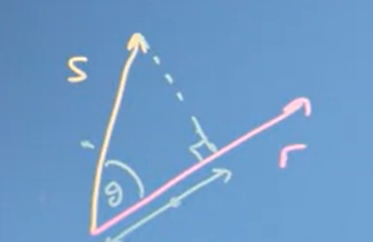

# Projection and Change of Basis

## **PROJECTION TOPIC** [Projection \| Coursera](<https://www.coursera.org/learn/linear-algebra-machine-learning/lecture/kjrpq/projection>)

We have 2 vectors, s and r. We are looking for s projection (Shade) to r. Aka how much s moves in direction to r.

1. If we look at the picture, then s is hypotenuse and its projection to r is $\theta$ adjacent(KÜLGNEV) side.
2. $cos (\theta) = \frac{adj}{hyp} = \frac{\text{|projection vector|}}{|s|} => |s| cos(\theta)   = \text{|projection vector|}$
3. From the  [angle derivation based on cosine rule](<https://app.notion.com/p/ANGLE-DEEP-DIVE-81a4f30190024db7a81946386017a84a?pvs=21>)  we get $s \cdot r = |r||s|cos(\theta)$
4. From previous we know $|s|cos(\theta)=|\text{projection vector}|$
5. Thus $s \cdot r = |r||\text{projection vector}|$
6. Thus $\frac{s\cdot r}{|r|} = \text{|projection vector|} = \text{Projection length of s onto r}$ (**Scalar Projection**)  **The lengths units are in standard basis here. Intuitiivselt ma leian skalaarkoruutisega kui palju vektor s läheb samal suunal, mis vektor r ning jagamisega tagan, et see “KUI PALJU” oleks standardbaasi mõõtühikutes.**
   1. if we are projecting on standard basis , then $|r|=1$ and projection to it becomes just regular dot product $s \cdot r$
7. $\frac{r}{|r|}= \text{Vector going within the same direction as r but with length 1}$ (Unit vector in direction of r
   1. Proof :$\sqrt{\sum{\frac{r_i}{|r|}}^2}=\sqrt{\frac{1}{|r|^2}\sum{r_i}^2}=\sqrt{\frac{1}{\sqrt{\sum{r_i^2}}^2}\sum{r_i}^2}=\sqrt{\frac{1}{\sum{r_i^2}}\sum{r_i}^2}=\sqrt{1}=1$
8. Scalar Projection \* Unit Vector in direction R = **Vector projection =** **$\frac{s\cdot r}{|r|} \cdot \frac{r}{|r|}$**
9. Projecting to different basis $\frac{s\cdot r}{|r|{|r|}}$ - explanation below.  **Opposing to regular projection, the length units are of r basis length here.**

## **CHANGE OF BASIS**

In the example above we are going to change the basis of the vector $r_e$ to use the basis $\hat{b_1},\hat{b_2}$

For this we first need to have the **new** basis $\hat{b_1},\hat{b_2}$ defined with $\hat{e}$ coordinates.

In this case

$b_1e= \begin{bmatrix} 2 \\ 1 \\ \end{bmatrix}=2*\hat{e_1}+1*\hat{e_2}$

$b_2e= \begin{bmatrix} -2 \\ 4 \\ \end{bmatrix}=-2*\hat{e_1}+4*\hat{e_2}$

Now we need to derive how r is looking like when described by basis b1 and b2

That means

- We need to describe r based on how much it goes towards $b_{1}$ and $b_2$ with length units of $b_{1}$ and $b_{2}$ accordingly.

To describe r by basis b for both b1 and b2 I need to

1. Get scalar projection of r to $b_i$. $=> \frac{r \cdot b_i}{|b_i|}$
2. Divide that scalar projection by $|b_i|$. We **need** to do this to describe direction to $b_i$ with **length** units of **basis** $b_i$ instead of **basis** $e_i$

**NB, et antud projektsiooni funktsionaalsus toimuks baasivahetuse puhul peavad uued baasivektorid olema omavahel risti.**

[NÄIDE MILLAL AINULT PROJEKTSIOON BAASIVAHETUSEKS EI TOIMI ](<https://app.notion.com/p/N-IDE-MILLAL-AINULT-PROJEKTSIOON-BAASIVAHETUSEKS-EI-TOIMI-ef73da9359e94974af4205ee8fe3c764?pvs=21>)
