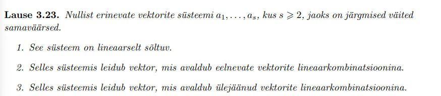
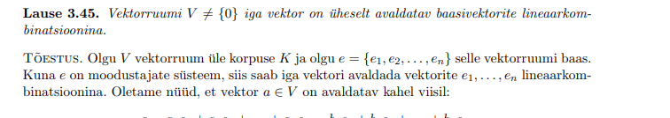
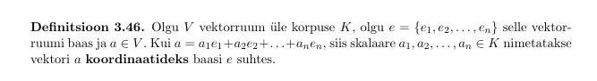
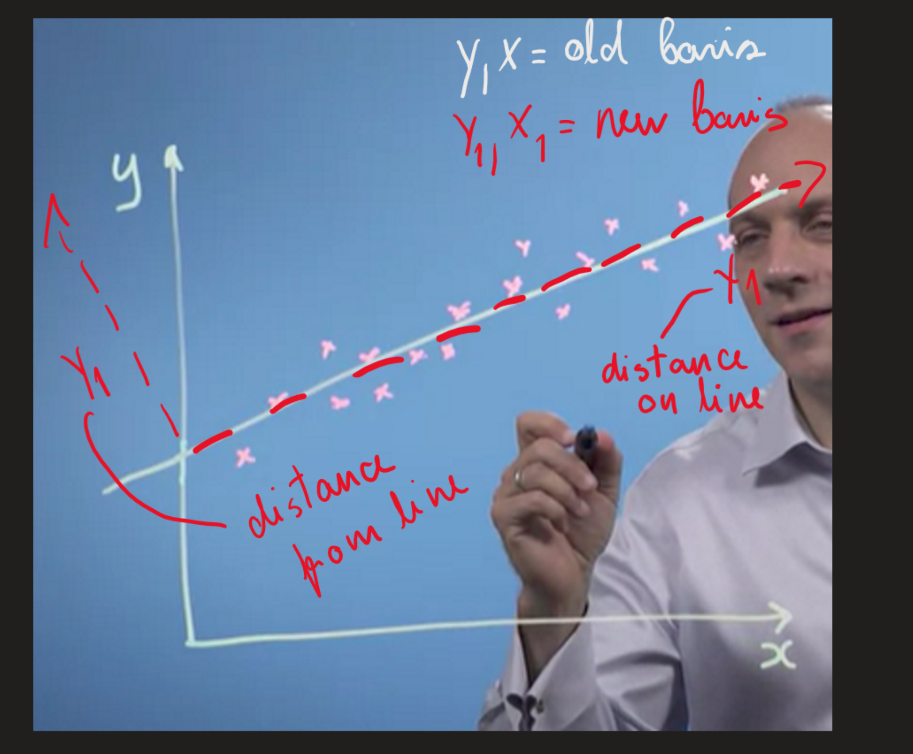
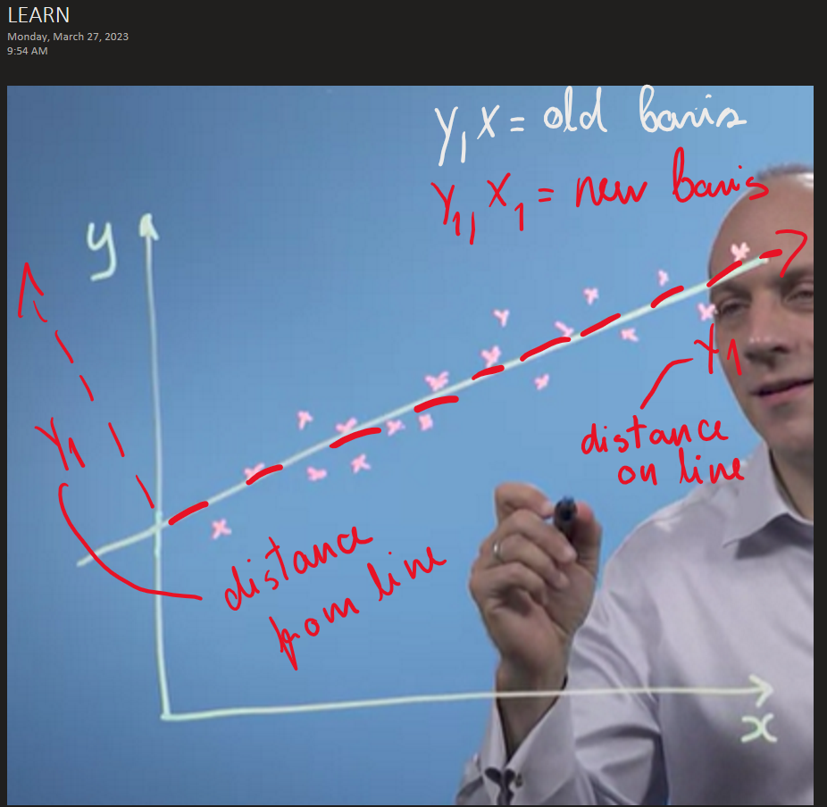

# WEEK 2 - VECTOR SPACE AND ..

- [TEOREETILISEMAD ALGEBRA OMADUSED](<#9bf2837f-0d06-4df6-8dea-79d089805dec>)
- [VECTOR PROPERTIES](<#0f48284b-7757-4020-86de-dee4ecece0e3>)
- [VEKTORRUUM JA KOORDINAATSÜSTEEM](<#bbfa8558-b0d4-462a-bfb2-0c7e01950463>)
  - [SPAN (MOODUSTAJATE SÜSTEEM) ](<#9732e137-cd27-42a2-a60b-7d587b5aada5>)
  - [LINEAARNE SÕLTUMATUS  ](<#7ae1e2a0-9f57-4ce2-8e98-94a17699040e>)
    - [**DEFINITSIOON:** ](<#cb45dc8a-baa2-4c6c-9cb4-e9e4d972c27c>)
    - [**LAUSE:** ](<#3e6e93fe-7ad0-44dd-babc-d51620ee526b>)
    - [PRAKTILISEM POOL](<#23623c45-f771-4d00-a25e-e59c26c0114c>)
  - [VEKTORRUUMI ALAMRUUM ](<#b76230ec-0256-4e8b-ae1c-860ba2dbc1ef>)
  - [BAASID - VEKTORRUUMI ALAMRUUMI BAAS](<#a77812c5-e893-44c5-8f87-df0abc0b48a4>)
    - [IGA VEKTOR AVALDATAV ÜHESELE BAASIVEKTORITE LINEAARKOMBINATSIOONINA](<#fe922db9-e3dc-4a67-b8b7-f4aadc8869e0>)
    - [KONTROLL, KAS VEKTORID ON BAASID  ](<#b60328ce-ece9-474c-87ba-f3a195bb5b22>)
  - [KOORDINAATSÜSTEEM JA BAASID](<#c24dee97-71ea-4f31-abd2-bbbcde5d2a23>)
- [Vektorruumide Teooria](<#2262e1a6-74b3-808a-9736-dbeba7bfffe8>)
- [VEKTORRUUM LAANE JÄRGI](<#3ae52458-86c4-454d-b404-83ea4a900e78>)
  - [ERINEVAD VEKTORRUUMID](<#cb8f3ee0-c76e-4ecb-bf53-3737c0384408>)
  - [VEKTORI KOORDINAADID ](<#8437d620-0f48-48a7-9d40-d47ac95a99b4>)
    - [**KOORDINAATSÜSTEEM - VEKTORRUUM VS EUKLEIDILINE RUUM VS GEOMEETRILINE RUUM** ](<#f6b7697f-1c02-4d0d-b6fd-41599677120c>)
- [ANGLE (separate page)](<#2e0441c9-23e5-4350-bb9e-2505e95cbf7a>)
- [VEKTORITEGA EDASI ](<#c099abf4-a7fb-4a0e-9a1a-a9a88f14e8cd>)
  - [DEFINING A PLANE IN R3 WITH A POINT AND NORMAL VECTOR](<#9d866b83-21e9-44df-9f03-c39f5b416b44>)
- [**PROJECTION TOPIC**](<#121253be-2e42-4513-99f2-884ba082201c>) [Projection \| Coursera](<https://www.coursera.org/learn/linear-algebra-machine-learning/lecture/kjrpq/projection>)
- [**CHANGE OF BASIS** ](<#319f2ead-72af-49fa-a9f5-47b34d7a5281>)
  - [QUIZ ABOUT BASIS SWITCHING USING PROJECTIONS](<#ca1e874b-7317-4d4d-a0d7-829d10034642>)
  - [REAL LIFE APPLICATIONS OF BASIS CHANGING ](<#939ce5d7-1d5f-46d0-b544-53a82b2af08d>)
  - [QUIZ ON SHIP MGNITUDE IN DIRECTION OF CURRET](<#ae9ba44a-94e6-49c5-87f1-d7543a7c51fd>)

TODO: ehitada see peatükk üles nii, et me viitame esmalt teoreetilisele algebrale ja sealt lähme edasi just realarvude kontekstis (osalt viidates teoreetilise algebra komponentidele)

## TEOREETILISEMAD ALGEBRA OMADUSED

Allpool praktilisema suunitlused tekstis me räägime Eukleidilistest vektoruumidest, s.t vektorruumidest, mille suhtes me eeldame,

- et on defineeritud skalaarkorrutamine
- on defineeritud pikkus

Samuti me räägime vektorruumidest, mis on defineeritud üle korpuse $\R$. Et aru saada nendest omandustest ja kitsendavatest eeldustest on hea, kui tutvuda \[TEOREETILISEMA ALGEBRA\] peatükiga.

## VECTOR PROPERTIES

1. Vector lengths calculation  $|\begin{bmatrix} a_1 \\ a_2 \\ \vdots \\ a_N \end{bmatrix}| = \sqrt{\sum a_i^2}$
2. Dot product $A \cdot B = \sum{a_i * b_i}$
   1. properties
      1. Commutative $A \cdot B=  B \cdot A$
      2. Associative with scalar multiplication  $A \cdot (cB) = c (A\cdot B)$
      3. Distributive with summation $A \cdot (B+C) = A \cdot B + A \cdot C$
      4. square root of dot product is equal to vector length  $A \cdot A = \sum a_i^2 => \sqrt{A\cdot A} = \text{Vector length}$
3. Dot product rules based on angles between vectors - [Deeper elaboration of concept](<https://app.notion.com/p/WEEK-2-VECTOR-SPACE-AND-a8ab50e9887b497d861abc2593236241?pvs=21>)
   1. $\theta=90  \degree => cos(\theta) = 0 => r \cdot s = 0$
   2. $\theta=0  \degree => cos(\theta) = 1 => A \dot B = |r|*|s|$ (If both vectors are of unit lenth then dot product = 1)
   3. $\theta=180  \degree => cos(\theta) = -1 => r \cdot s = -|s|*|s|$

## VEKTORRUUM JA KOORDINAATSÜSTEEM

### SPAN (MOODUSTAJATE SÜSTEEM)

[Linear combinations and span (video) \| Khan Academy](<https://www.khanacademy.org/math/linear-algebra/vectors-and-spaces/linear-combinations/v/linear-combinations-and-span>) (e. keeles - moodustajate süsteem)

- Näidati, kuidas tõestada, kas 2 vektorit saavad olla mingi hulga (Näiteks R2) span.
  - Põhimõtteliselt tehti väide, et vektorite {e} kaudu on võimalik jõuda suvalise vektori x-ni.
  - Siis lahendati üldine lineearavõrrandisüsteem. Kui jõuad lahenduseni, siis on võimalik jõuda

### LINEAARNE SÕLTUMATUS  

Tähendab, et meil sisuliselt puuduvad ebavajalikud vektorid. Iga vektor annab dimensionaalselt uut informatsiooni.

[Algebra, Valdis Laan](<https://tartuulikool-my.sharepoint.com/personal/antsnamm_ut_ee/_layouts/15/onedrive.aspx?id=%2Fpersonal%2Fantsnamm%5Fut%5Fee%2FDocuments%2FDoktorit%C3%B6%C3%B6%2FArtiklid%2FAlgebraKonspekt%2Epdf&parent=%2Fpersonal%2Fantsnamm%5Fut%5Fee%2FDocuments%2FDoktorit%C3%B6%C3%B6%2FArtiklid>) lk 30

[More on linear independence (video) \| Khan Academy](<https://www.khanacademy.org/math/linear-algebra/vectors-and-spaces/linear-independence/v/more-on-linear-independence>)

[Span and linear independence example (video) \| Khan Academy](<https://www.khanacademy.org/math/linear-algebra/vectors-and-spaces/linear-independence/v/span-and-linear-independence-example>)

#### **DEFINITSIOON:**

Vektorite süsteemi nimetatakse lineearselt sõltumatuks, kui kehtib reegel

$c_1v_1+c_2v_2+..+c_iv_i=0 ⇒ c_1=c_2=c_3=..=c_i=0$

Vektorite süsteem on lineearselt sõltuv, kui **ta ei ole lineaarselt sõltumatu. S.t**

$c_1v_1+c_2v_2+..+c_iv_i=0 ,\exists  c_j \neq 0$ ⇒ on vektorite süsteem lineaarselt sõltuv definitsiooni järgselt.

#### **LAUSE:**

TÕESTUS 1. ⇒ 2.

$c_1v_1+c_2v_2+..+c_jv_j+..+c_iv_i=0 ,\exists  c_j \neq 0$

Oletame, et  $c_j \neq 0$, viime selle teisele poole võrdusmärki

$c_1v_1+c_2v_2+..+c_iv_i=-c_jv_j ,  c_j \neq 0$ $<=>$ Selles süsteemis leidub vektor, mis avaldub eelnevat lineearkombinatsioonina.

TÕESTUS 2. ⇒ 1.

elementaarne 😀

#### PRAKTILISEM POOL

- Kuidas kontrollida lineaarset sõltumatust? Lahendad võrrandi $a_1v_1+a_2v_2 + .. + a_iv_i = 0$, kus eesmärgiks leid $a_i$. Kui ainus lahend 0, siis on ka lineearne sõltumatus .

### VEKTORRUUMI ALAMRUUM

[Linear subspaces (video) \| Khan Academy](<https://www.khanacademy.org/math/linear-algebra/vectors-and-spaces/subspace-basis/v/linear-subspaces>)

On mingi kinnine alamahulk vektorruumist.

Kinnine tähendab, et

1. Skalaariga korrutamine ükskõik millise alamruumi elemendiga ei vii alamruumist välja
2. Kahe vektori omavaheline liitmine ei vii vektorruumi alamruumist välja

Questions

1. Is the span of some set of vectors a subsapace - Yes, because it closed under addition, multiplication with scalar and has 0 vector in it.

### BAASID - VEKTORRUUMI ALAMRUUMI BAAS

Baas on väikseim kogus vektorreid, mis on mingi vektorruumi moodustajate süsteem. Puudub redundancy.

Basis definition - [Basis of a subspace (video) \| Khan Academy](<https://www.khanacademy.org/math/linear-algebra/vectors-and-spaces/subspace-basis/v/linear-algebra-basis-of-a-subspace>)

#### IGA VEKTOR AVALDATAV ÜHESELE BAASIVEKTORITE LINEAARKOMBINATSIOONINA

LK 38 Valdis Laane algebra õpik

Kui e on vektorruumi baas, siis on ta

1. Vektorruumi moodustajate süsteem
2. Lineaarselt sõltumatu

Vastuväitelise tõestuse abil, oletame et leidub 2 viisi kuidas avaldada vektorit. Lahutame nüüd need üksteisest

$(a_1-b_1)e_1 +  (a_2-b_2)e_2 + .. (a_i-b_i)e_i = 0; \text{Kuna baasid on lineearselt sõltumatud, siis definitsioonist järeldub} (a_1-b_1)=(a_2-b_2)=..=(a_1-b_1)=0$

Viimasest järeldub, et kõik a = b ja $\forall$ vektor avaldub üheselt.

#### KONTROLL, KAS VEKTORID ON BAASID

Meil on baasid $e_1,e_2,e_3$

**Kontrollime, et SPAN on** **$\R_3$**

Selleks lahendame võrrandi, kus meil on vektor   $x=c_1e_1+c_2e_2+c_3e_3=\begin{pmatrix} a \\ b \\ c \end{pmatrix}$

Leiame mis on $c_1,c_2,c_3$

$a,b,c$ suhtes. a,b,c on suvalised vektorid.

Kui leidub **ühene** lahend, siis span on $\R_3$

**Kontrollime, et** **$e_1,e_2,e_3$** **on lineaarselt sõltumatud.**

Kui oleme leidnud lahendus c1,c2,c3-le, a,b,c suhtes, siis asendame a=b=c=0 ja vaatame, et selle tulemusena c1=c2=c3=0

### KOORDINAATSÜSTEEM JA BAASID

Mind ajas närvi see video räägiti Spanist mingite baaside suhtes ning seal kasutati vektoreid a ja b, mille suhtes oli siis see Span defineeritud. See iseenesest on okei,  aga see a ja b iseenesest olid vektorid, mis olid ise ka defineeritud baaside \[1,0\] ja \[0,1\] suhtes.

***Ma hakkasin mõtlema siinkohal, et milliste baaside suhtes see pagana \[1,0\] ja \[0,1\] siis üldiselt defineeritud on?***

Sellele vastamiseks vaatame kõigepealt korraks, mis on vektorruum:

## Vektorruumide Teooria

## VEKTORRUUM LAANE JÄRGI

Enne teoreetilisema algebra osa tegelesime rohkem Eukleidilise ruumiga. Kus on mingi Skalaarkorrutis, Nurk, Pikkus jne juba defineeritud . Nüüd räägime vektorruumist veits abstraktsemalt.

- Oluline siin mõelda, et vektorruum on mingi vektor ja skalaar üle korpuse F ,
  - kus vektorite vahel tehe V x V → V
  - kus skalaar korrutada vektoriga K x V → V
- Vektor ei pea olema ilmtingimata mingi dimensiooniga, vektorit võib käsitleda ka funktsioonina või millegi kolmandana, peaasi, et oleks ülalkirjeldatud omadused olemas.

### ERINEVAD VEKTORRUUMID

- Üldine vektorruum
- Eukleidiline

### VEKTORI KOORDINAADID

**Hästi oluline väide on just “Vektori koordinaadi baasi suhtes”. See on see kontekst, mis pidi me vaatame. Me ei pea vektorit defineerima mingi konkreetse baasi suhtes. Kuigi üldjoontes seda tehaks.**

Valdis Laane Algebra konspektist [kon.pdf (ut.ee)](<https://courses.ms.ut.ee/MTMM.00.038/2022_fall/uploads/Main/kon.pdf>) ja Väljakoga rääkimisest saab tuletada

- Vektorruumi ja vektorite defineerimiseks pole  otseselt baase vaja.

Me saame öelda, et vektorit võib kirjeldada läbi mingi baasi, kuid seda ei pea tegema. Kui me kirjeldame vektorit läbi tema baasi kordajate (.s.t väjendame, et mingi vektor on $\sum{k_i e_i }$ kus $k \in K$), <mark>siis käsitleme me vektorit läbi tema koordinaatide.  [</mark><mark><a href="https://courses.ms.ut.ee/MTMM.00.038/2022_fall/uploads/Main/kon.pdf">Laan 38</a></mark><mark>]</mark>

- Kui me vaatame \[1,0\] ja \[0,1\] baasivektoreid, siis nood ei pea otseselt viitama baasivektorile vaid lihtsalt vektorruumi ÜHIKUTELE. Tihtilugu (kuid mitte alati) just korpuse ühikutele, mille peale konkreetne vektor $v\in K^n$ üldse defineeritud on.

Kui me räägime sellest, et kaks baasi on omavahel ortogonaalsed, siis me eeldame, et me oleme eukleidilises ruumis, kus baasidevahelist ortogonaalsust me kontrollime baaside enda ühikute suhtes. Eukleidilises ruumis on kaks baasi omavahel ortogonaalsed, e. risti (nurgaga 90 $\degree$), kui nendevahelina dot product = 0

Samas väga palju defineeritakse vektorruumi läbi baaside, sest baaside peale defineeritud omadustele saab defineerida ka palju vektorruumi omadusi. See on sellise toreda asja nagu span (Moodustiste süsteem) pärast.

#### **KOORDINAATSÜSTEEM - VEKTORRUUM VS EUKLEIDILINE RUUM VS GEOMEETRILINE RUUM**

[KOORDINAATSÜSTEEMIDE JA VEKTORRUUMIDE SEOS](<https://app.notion.com/p/KOORDINAATS-STEEMIDE-JA-VEKTORRUUMIDE-SEOS-1692e1a674b38016915fe31946dafb45?pvs=21>)

## ANGLE (separate page)

[ANGLE DEEP DIVE](<https://app.notion.com/p/ANGLE-DEEP-DIVE-81a4f30190024db7a81946386017a84a?pvs=21>)

## VEKTORITEGA EDASI

### DEFINING A PLANE IN R3 WITH A POINT AND NORMAL VECTOR

Plane - tasand

[https://www.khanacademy.org/math/linear-algebra/vectors-and-spaces/dot-cross-products/v/defining-a-plane-in-r3-with-a-point-and-normal-vector](<https://www.khanacademy.org/math/linear-algebra/vectors-and-spaces/dot-cross-products/v/defining-a-plane-in-r3-with-a-point-and-normal-vector>)

- Võtame suvalise punkti R3s ja seda punkti läbiva tasandiga risti oleva vektori. Me saame läbi selle defineerida tasandi.
- Tasandiga risti olemine tähendab, et kui on võetud 2 suvalist vektorit tasandi peal, ja nende vahele defineeritud vektor, siis selle vektoriga ollakse risti

Kui meil on nüüd defineeritud mingi konkreetne punkt x0=\[x0,y0,z0\] ja sellega risti olev vektor n =\[n1,n2,n3\] , siis saame võtta suvalise punkti tasandi peal x0=\[x,y,z\] ning defineerida tasandi peal oleva vektori läbi (x-x0), siis faktist, et vektor n on tasandiga risti tekib meil võrratus

$n \cdot (x-x_0)=0$. Kui nüüd seda võrratust näitlikustada ja asendada x0 ja n mingite konkreetsete vektoritega ja see välja arvutada, tekib meil üldteada tuntud tasandi võrrant

aX+By+Cz=D

## **PROJECTION TOPIC** [Projection \| Coursera](<https://www.coursera.org/learn/linear-algebra-machine-learning/lecture/kjrpq/projection>)

[Projection and Change of Basis](vector_projection_and_basis.md)

## **CHANGE OF BASIS**

[Change of Basis](vector_projection_and_basis.md#319f2ead-72af-49fa-a9f5-47b34d7a5281)

### QUIZ ABOUT BASIS SWITCHING USING PROJECTIONS

[QUIZ (1)](<https://app.notion.com/p/QUIZ-1-d3ca5e21277944d28d33789b22bddcf6?pvs=21>)

### REAL LIFE APPLICATIONS OF BASIS CHANGING

[Applications of changing basis \| Coursera](<https://www.coursera.org/learn/linear-algebra-machine-learning/lecture/vcCr6/applications-of-changing-basis>)

- In this case we have data and with linear regression have created a function $y=a + bx$ where a and b are fitted to best suit the line
- If we print the **function** and the **points** out in our coordinate system with y and x we see visually the difference between the points and the line.
- Another way to look at it would be to change the basis such that x\_1 and y\_1 would be the basis vectors.
  - So that
    - **Y1 - Distance from line**
    - **X2 - Distance on line**
  - This would give us a different perspective to look at the results which in data science can be a very useful thing to have.
- This means that if currently we are looking at each point as a representation of
  - $\text{point x scalar}_{i}*x+\text{point y scalar}_{i}*y$
  - we would be looking the same point in the context of $y_1,x_1$
    - $\text{point x\_1 scalar}_{i}*x+\text{point y\_1 scalar}_{i}*y$
- For this we would need to
  1. Find the representation of vectors $x_1,y_1$ with basis vectors x and y.
  2. For each point now  for $x_1$
     1. calculate the scalar projection to $x_1$ : $\text{scalar}$  . This gives us how far the line $x_1$ that specific point is.
     2. $\text{Point coordinates on basis x\_1}=\frac{\text{scalar}}{|x_1|}$ we do this to get the the distance on line $x_1$ with length units of $x_1$
        1. if the length of $x_1$ is 1 then $\text{Point coordinates on basis x\_1} =\text{Point Scalar projection to x\_1}$
  3. For each point now for $y_2$
     1. calculate the scalar projection to $y_1$ : $\text{scalar}$. This gives us how far the point is from the function linge $x_1$
     2. $\text{Point coordinates on basis y\_1}=\frac{\text{scalar}}{|y_1|}$ we do this to get the the distance on line $y_1$ with length units of $y_1$
        1. if the length of $y_1$ is 1 then $\text{Point coordinates on basis y\_1} =\text{Point Scalar projection to y\_1}$

### QUIZ ON SHIP MGNITUDE IN DIRECTION OF CURRET

[QUIZ - WEEK SUMMARY (1)](<https://app.notion.com/p/QUIZ-WEEK-SUMMARY-1-166f776fd3d948608a59c56ceb6f76b9?pvs=21>)

[PYTHAGORAS PROOF](<https://app.notion.com/p/PYTHAGORAS-PROOF-8f09249c2fb94c1eb4d910783e14bf82?pvs=21>)
